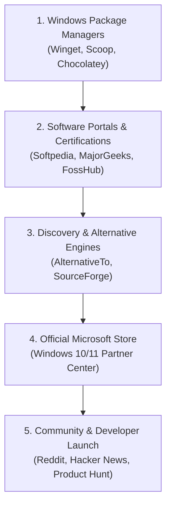

# 🚀 DodaZip Global Distribution & Growth Playbook

> **Complete Step-by-Step Implementation Guide for Distributing DodaZip as a 100% Free & Open-Source Tool.**  
> *Follow each phase sequentially to establish global reach, high domain-authority backlinks, and automated package installs.*

---

## 📋 Distribution Roadmap Overview



---

## 📌 Fast Reference: Core Metadata

Keep this information handy when filling out submission forms:

| Field | Official Value |
| :--- | :--- |
| **Software Name** | DodaZip |
| **Current Version** | `v0.2.0` |
| **Tagline** | Next-generation self-healing archiver and deduplicating encrypted vault in Rust |
| **Category** | Utilities / File Compression / Archivers |
| **License** | Open Source (Dual MIT / Apache-2.0) |
| **Official Website** | `https://dodatech.com/software/dodazip/` |
| **Documentation** | `https://dodatech.com/docs/dodazip/` |
| **GitHub Repository** | `https://github.com/dodatechcom/dodazip` |
| **Setup Installer (.exe)** | `https://github.com/dodatechcom/dodazip/releases/download/v0.2.0/DodaZip-Setup-v0.2.0.exe` |
| **Portable Package (.zip)** | `https://github.com/dodatechcom/dodazip/releases/download/v0.2.0/DodaZip-v0.2.0-windows-x64-portable.zip` |
| **Publisher** | DodaTech (WholeSale2c) |
| **Support Email** | `contact@dodatech.com` |

---

## 1️⃣ Phase 1: Windows Package Managers

Windows package managers allow hundreds of thousands of developers, power users, and enterprise system administrators to install DodaZip silently in seconds from the command line.

---

### Step 1.1: Microsoft Windows Package Manager (`winget`)
**Impact:** Native to all Windows 10 (1809+) & Windows 11 PCs.

#### Option A: Using `wingetcreate` CLI (Automated & Recommended)
1. Install the official Microsoft Winget manifest generator in PowerShell:
   ```powershell
   winget install Microsoft.WingetCreate
   ```
2. Run the generator targeting the official DodaZip installer:
   ```powershell
   wingetcreate new https://github.com/dodatechcom/dodazip/releases/download/v0.2.0/DodaZip-Setup-v0.2.0.exe
   ```
3. Follow the interactive prompts:
   - **PackageIdentifier:** `DodaTech.DodaZip`
   - **PackageVersion:** `0.2.0`
   - **PackageName:** `DodaZip`
   - **Publisher:** `DodaTech`
   - **Moniker:** `dodazip`
   - **License:** `MIT OR Apache-2.0`
   - **ShortDescription:** Next-gen memory-safe compression suite and encrypted vault with FastCDC deduplication and self-healing parity.
4. When prompted, select **Submit PR to GitHub**. It will automatically fork `microsoft/winget-pkgs`, upload your manifest, and open a submission PR!

#### Option B: Manual GitHub PR Manifest
If submitting manually, create three files in the repository `microsoft/winget-pkgs/manifests/d/DodaTech/DodaZip/0.2.0/`:

1. `DodaTech.DodaZip.yaml`:
   ```yaml
   PackageIdentifier: DodaTech.DodaZip
   PackageVersion: 0.2.0
   DefaultLocale: en-US
   ManifestType: version
   ManifestVersion: 1.6.0
   ```

2. `DodaTech.DodaZip.installer.yaml`:
   ```yaml
   PackageIdentifier: DodaTech.DodaZip
   PackageVersion: 0.2.0
   MinimumOSVersion: 10.0.0.0
   InstallerType: inno
   Scope: machine
   InstallModes:
     - interactive
     - silent
     - silentWithProgress
   Installers:
     - Architecture: x64
       InstallerUrl: https://github.com/dodatechcom/dodazip/releases/download/v0.2.0/DodaZip-Setup-v0.2.0.exe
       InstallerSha256: 0ca81ba31b26b5c00713beaa07b961c0d51be8c9be951a37c385c490a618d3ef
   ManifestType: installer
   ManifestVersion: 1.6.0
   ```

3. `DodaTech.DodaZip.locale.en-US.yaml`:
   ```yaml
   PackageIdentifier: DodaTech.DodaZip
   PackageVersion: 0.2.0
   PackageLocale: en-US
   Publisher: DodaTech
   PublisherUrl: https://dodatech.com/
   PublisherSupportUrl: https://support.dodatech.com/
   PackageName: DodaZip
   PackageUrl: https://dodatech.com/software/dodazip/
   License: MIT OR Apache-2.0
   LicenseUrl: https://github.com/dodatechcom/dodazip/blob/main/LICENSE-MIT
   ShortDescription: High-performance memory-safe compression suite and self-healing encrypted vault.
   Tags:
     - zip
     - 7zip
     - compression
     - archiver
     - deduplication
     - encryption
     - rust
   ManifestType: defaultLocale
   ManifestVersion: 1.6.0
   ```

---

### Step 1.2: Scoop (`scoop.sh`)
**Impact:** The developer standard for portable installations without admin prompts.

1. Fork the community bucket repository: [ScoopInstaller/Extras](https://github.com/ScoopInstaller/Extras).
2. Create `bucket/dodazip.json`:
   ```json
   {
       "version": "0.2.0",
       "description": "High-performance memory-safe archiver and self-healing encrypted vault",
       "homepage": "https://dodatech.com/software/dodazip/",
       "license": "MIT|Apache-2.0",
       "architecture": {
           "64bit": {
               "url": "https://github.com/dodatechcom/dodazip/releases/download/v0.2.0/DodaZip-v0.2.0-windows-x64-portable.zip",
               "hash": "bcfdc8a74ec74191d575704d9c49089db0f55cf64d3faef85ce70e9a59b3d0ee"
           }
       },
       "bin": [
           "dodazip.exe",
           ["dodazip-ui.exe", "dodazip-gui"]
       ],
       "shortcuts": [
           ["dodazip-ui.exe", "DodaZip"]
       ],
       "checkver": {
           "github": "https://github.com/dodatechcom/dodazip"
       },
       "autoupdate": {
           "architecture": {
               "64bit": {
                   "url": "https://github.com/dodatechcom/dodazip/releases/download/v$version/DodaZip-v$version-windows-x64-portable.zip"
               }
           }
       }
   }
   ```
3. Open a Pull Request to `ScoopInstaller/Extras`. Once merged, users can install with:
   ```powershell
   scoop bucket add extras
   scoop install dodazip
   ```

---

### Step 1.3: Chocolatey (`chocolatey.org`)
1. Create a free account at [Chocolatey.org](https://community.chocolatey.org/).
2. Obtain your API key from your profile.
3. Use the `choco new` template to create the package:
   ```powershell
   choco new dodazip --version=0.2.0
   ```
4. Point `chocolateyInstall.ps1` to `DodaZip-Setup-v0.2.0.exe` with silent args `/VERYSILENT /SUPPRESSMSGBOXES /NORESTART`.
5. Pack and push:
   ```powershell
   choco pack
   choco push dodazip.0.2.0.nupkg --api-key="YOUR_KEY"
   ```

---

## 2️⃣ Phase 2: Curated Software Portals & Certification Badges

These portals give you direct organic search traffic and award **antivirus trust badges** that you can place on `dodatech.com`.

---

### Step 2.1: Softpedia (Top Priority)
- **URL:** [https://www.softpedia.com/developer/](https://www.softpedia.com/developer/) (or email `submit@softpedia.com`)
- **Submission Process:**
  1. Click **Submit Software** -> Free Submission.
  2. Enter the Product Name: `DodaZip`.
  3. Enter Download Link: `https://github.com/dodatechcom/dodazip/releases/download/v0.2.0/DodaZip-Setup-v0.2.0.exe`.
  4. Enter Portable Download Link: `https://github.com/dodatechcom/dodazip/releases/download/v0.2.0/DodaZip-v0.2.0-windows-x64-portable.zip`.
  5. Category: `System -> Compression Tools`.
  6. Softpedia's lab will test the binary against VirusTotal and issue the **"Softpedia 100% Clean: No Spyware, No Adware, No Viruses"** award badge.
  7. Copy their SVG badge and link it on `https://dodatech.com/software/dodazip/`.

---

### Step 2.2: MajorGeeks
- **URL:** [https://www.majorgeeks.com/content/page/contact_us.html](https://www.majorgeeks.com/content/page/contact_us.html)
- **Submission Process:**
  - Send an email to `webmaster@majorgeeks.com` with subject:  
    `[Software Submission] DodaZip v0.2.0 - Free Open Source Archiver & Encrypted Vault`
  - Body template:
    > Hi MajorGeeks Team,  
    > We'd love to submit DodaZip for your listing.  
    > DodaZip is a fast, free, open-source file archiver written in 100% memory-safe Rust with modern features not present in 7-Zip: content-defined FastCDC deduplication, Reed-Solomon self-healing parity, Argon2id encryption, and a modern Acrylic UI.  
    >  
    > - Download (Installer): https://github.com/dodatechcom/dodazip/releases/download/v0.2.0/DodaZip-Setup-v0.2.0.exe  
    > - Download (Portable): https://github.com/dodatechcom/dodazip/releases/download/v0.2.0/DodaZip-v0.2.0-windows-x64-portable.zip  
    > - Homepage: https://dodatech.com/software/dodazip/  
    > - License: Open Source (MIT / Apache-2.0)  
    > Clean of all adware/telemetry. Thanks for your review!

---

### Step 2.3: FossHub
- **URL:** [https://www.fosshub.com/contact.html](https://www.fosshub.com/contact.html)
- **Why:** FossHub rejects all adware and only hosts pristine open-source software. Hosting here gives elite credibility.
- **Submission Process:**
  - Submit through their Contact Form under **"Suggest / Submit a Free & Open Source Project"**.
  - Provide the GitHub link: `https://github.com/dodatechcom/dodazip`.

---

### Step 2.4: FileHorse & SnapFiles
- **FileHorse:** [https://www.filehorse.com/contact/](https://www.filehorse.com/contact/) (Select "Submit Software").
- **SnapFiles:** [https://www.snapfiles.com/submit.html](https://www.snapfiles.com/submit.html) (Free standard listing).

---

## 3️⃣ Phase 3: Discovery Engines & Competitor Alternatives

This is where users actively switch from WinRAR and 7-Zip to DodaZip.

---

### Step 3.1: AlternativeTo (Highest Conversion Channel)
- **URL:** [https://alternativeto.net/software/create/](https://alternativeto.net/software/create/)
- **Submission Checklist:**
  - **Item Name:** `DodaZip`
  - **Website:** `https://dodatech.com/software/dodazip/`
  - **License:** `Open Source (Free)`
  - **Platforms:** `Windows` (and `Linux` via CLI)
  - **Alternatives to (Choose all):**
    1. `7-Zip`
    2. `WinRAR`
    3. `Bandizip`
    4. `PeaZip`
    5. `WinZip`
  - **Tags:** `file-compression`, `file-archiver`, `encryption`, `deduplication`, `rust`, `open-source`, `self-healing`, `acrylic-ui`.
  - **Description:**  
    *DodaZip is a modern, memory-safe compression suite and cryptographic vault built in Rust. It introduces the `.dzip` format with content-defined chunk deduplication (FastCDC), Reed-Solomon self-healing parity to automatically recover from silent bit-rot, Argon2id + XChaCha20-Poly1305 zero-knowledge encryption, and a built-in 3-pass DoD 5220.22-M file shredder. Supports 14 archive formats.*

---

### Step 3.2: SourceForge Project Mirror
- **URL:** [https://sourceforge.net/create/](https://sourceforge.net/create/)
- **Why:** SourceForge has domain authority 93. Hosting a mirror here gives DodaTech high-authority backlinks, automatic worldwide download mirrors, and weekly download statistics.
- **Setup:**
  1. Register project name: `dodazip`.
  2. Link the repository to auto-import releases from GitHub or upload `DodaZip-Setup-v0.2.0.exe`.
  3. SourceForge automatically generates an embeddable download button for website landing pages.

---

## 4️⃣ Phase 4: Official Microsoft Store (Windows 11 / 10)

Listing on the Microsoft Store gives DodaZip organic visibility across hundreds of millions of Windows PCs without scary SmartScreen warnings.

---

### Prerequisites:
1. Microsoft Partner Center Account: [partner.microsoft.com](https://partner.microsoft.com/) (one-time ~$19 registration fee for individuals, ~$99 for companies).
2. Reserved App Name: `DodaZip`.

### Submission Method: Traditional Desktop `.exe` (Simplest & Direct)
Under Microsoft's modernized store policies, you do **not** need to convert your app to UWP or MSIX:
1. In Partner Center, click **New App** -> Enter name `DodaZip`.
2. Under **Product distribution**, choose:
   - **Distribution method:** *I want to host the installer on my own URL* (or upload the installer directly).
   - **Installer URL:** `https://github.com/dodatechcom/dodazip/releases/download/v0.2.0/DodaZip-Setup-v0.2.0.exe`
   - **Installer Type:** `Inno Setup / Executable`
   - **Silent install parameters:** `/VERYSILENT /SUPPRESSMSGBOXES /NORESTART`
3. Fill out the Store Listing:
   - Upload 4 screenshots of the Acrylic UI and context menu.
   - Set age rating to **All ages / 3+**.
   - Price: **Free**.
4. Submit for certification (typically approved within 24–48 hours).

---

## 5️⃣ Phase 5: Developer & Community Launch Playbook

Launch DodaZip on developer hubs with transparent, engineering-focused storytelling.

---

### Step 5.1: Hacker News ("Show HN")
- **Best Day & Time:** Tuesday or Wednesday between 6:30 AM – 8:30 AM PST (8:00 PM – 10:00 PM IST).
- **Format:** Plain text with direct links.
- **Title:**  
  `Show HN: DodaZip – Memory-safe archiver in Rust with self-healing parity & deduplication`
- **Body:**
  > Hi HN,  
  > We built DodaZip (https://dodatech.com/software/dodazip/), an open-source file compression suite and encrypted vault written in 100% memory-safe Rust with a Tauri desktop GUI.  
  >  
  > Traditional tools like 7-Zip and WinRAR were architected decades ago and lack two critical features for modern workloads:  
  > 1. **Content-Defined Deduplication (FastCDC):** When storing repeated disk builds or daily backups, identical chunks are identified and stored only once (yielding 2–10x higher compression than ZIP).  
  > 2. **Self-Healing Parity (Reed-Solomon ECC):** Archives automatically self-repair when storage sectors degrade or bit-rot strikes.  
  > 3. **Argon2id + XChaCha20-Poly1305:** GPU-resistant key derivation hiding filenames, structures, and data.  
  >  
  > It supports 14 standard formats (.zip, .7z, .rar, .tar, .xz, .iso, etc.) with Windows Explorer right-click integration.  
  >  
  > GitHub: https://github.com/dodatechcom/dodazip  
  > Documentation: https://dodatech.com/docs/dodazip/  
  >  
  > Would love your feedback on the architecture, chunking benchmarks, and format design!

---

### Step 5.2: Reddit Communities
Post clean, non-promotional demonstrations on these subreddits:
1. **`r/rust`**:
   - Focus: *"We built a cross-platform archiver using Tauri 2.0, FastCDC, and Reed-Solomon novel polynomial in Rust. Here's our architecture."*
2. **`r/software`**:
   - Focus: *"A clean, modern, ad-free alternative to WinRAR/7-Zip with Windows 11 Acrylic styling."*
3. **`r/freeware`**:
   - Focus: *"100% free and open-source file compression tool without telemetry or bundled bloatware."*

---

### Step 5.3: Product Hunt Launch
- **Listing Type:** Free Developer Tool / Productivity.
- **Asset Checklist:**
  - [ ] App Icon (240x240 PNG on transparent background).
  - [ ] 5 Feature Gallery Slides (Acrylic dark theme, virtual file viewer, benchmark screen, self-healing demo).
  - [ ] 60-second animated GIF or YouTube video walkthrough.
  - [ ] Maker Comment explaining the story behind building DodaZip.

---

## 📅 Actionable Implementation Checklist

Use this tracker to mark off platforms as you complete them:

- [ ] **Phase 1: Package Managers**
  - [ ] Winget manifest submitted (`wingetcreate`)
  - [ ] Scoop extras bucket PR submitted
  - [ ] Chocolatey package submitted
- [ ] **Phase 2: Portals & Certifications**
  - [ ] Softpedia submission sent
  - [ ] Softpedia "100% Clean" badge added to `dodatech.com`
  - [ ] MajorGeeks submission sent
  - [ ] FossHub open-source listing requested
  - [ ] FileHorse submission completed
- [ ] **Phase 3: Discovery Engines**
  - [ ] AlternativeTo listing created (targeting WinRAR & 7-Zip)
  - [ ] SourceForge mirror created
- [ ] **Phase 4: Official App Store**
  - [ ] Microsoft Partner Center listing published
- [ ] **Phase 5: Community Launch**
  - [ ] Hacker News "Show HN" posted
  - [ ] Reddit `r/rust` and `r/software` posts shared
  - [ ] Product Hunt launch scheduled
