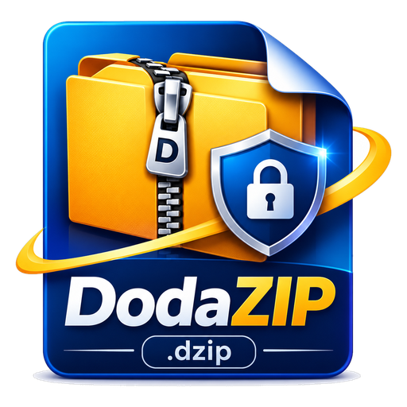

<p align="center">
  
</p>

<h1 align="center">DodaZip</h1>

<p align="center">
  <strong>Next-Generation Self-Healing Compression & Encrypted Vault</strong><br>
  Built with 100% memory-safe Rust and modern Acrylic UI. Engineered for privacy, maximum data integrity, and cross-file deduplication.
</p>

<p align="center">
  <a href="https://github.com/dodatechcom/dodazip/releases/latest"></a>
  <a href="LICENSE-MIT"></a>
  
  
  
</p>

---

<p align="center">
  <a href="https://github.com/dodatechcom/dodazip/releases/download/v0.2.0/DodaZip-Setup-v0.2.0.exe">
    
  </a>
  &nbsp;&nbsp;
  <a href="https://github.com/dodatechcom/dodazip/releases/download/v0.2.0/DodaZip-v0.2.0-windows-x64-portable.zip">
    
  </a>
</p>

---

## 💡 Why DodaZip?

Traditional compression software was created decades ago when storage was expensive and cyber threats were simple:
* **7-Zip** (1999) has strong compression, but its interface is frozen in the Windows 98 era, it uses legacy PBKDF2 encryption (easily cracked with modern GPU clusters), and **it provides zero self-healing**—a single flipped byte corrupts your entire archive forever.
* **Windows Built-in ZIP** uses the ancient 1993 DEFLATE algorithm, lacks cross-file deduplication, uses breakable legacy encryption, and dumps files all over your desktop without zip-bomb protection.

**DodaZip is built from the ground up for 2026 and beyond.** It pairs state-of-the-art Zstandard and LZMA2 compression with **Reed-Solomon self-healing parity**, **FastCDC deduplication**, **GPU-resistant Argon2id + XChaCha20-Poly1305 encryption**, and a **DoD 3-pass permanent file shredder**.

---

## ⚡ Feature Comparison Matrix

| Feature | 🛡️ **DodaZip** | 📦 **7-Zip** | 🪟 **Windows Built-in ZIP** |
| :--- | :---: | :---: | :---: |
| **Self-Healing ECC Recovery** | **Automatic (Reed-Solomon)**<br>*(Self-repairs bitrot & bad drive sectors)* | ❌ None<br>*(Archive corrupts on 1 bad byte)* | ❌ None<br>*(Throws generic extraction error)* |
| **Cross-File Deduplication** | **Content-Defined (FastCDC)**<br>*(Eliminates duplicate blocks across files)* | ⚠️ Limited Solid Block only | ❌ None |
| **Cryptographic Encryption** | **XChaCha20-Poly1305 + Argon2id**<br>*(Memory-hard, GPU/ASIC brute-force resistant)* | AES-256 + PBKDF2<br>*(Vulnerable to modern GPU clusters)* | Legacy ZipCrypto or standard AES<br>*(Trivially breakable)* |
| **Permanent Secure Shred** | **3-Pass DoD 5220.22-M + MFT scrub**<br>*(Zero-fill + One-fill + Random noise)* | ❌ None<br>*(Plaintext files remain on drive)* | ❌ None<br>*(Normal delete leaves raw data on disk)* |
| **Modern Desktop UI** | **Modern Acrylic Glass UI**<br>*(Tabs, breadcrumbs, search, dark/light)* | Legacy Windows 98 interface | Basic File Explorer folder |
| **Zip Bomb & Clutter Guard** | **Smart Unpack**<br>*(Auto-creates folder for multi-root archives)* | ⚠️ Manual option only | ❌ None<br>*(Dumps files everywhere)* |
| **Executable Threat Shield** | **Flags deceptive scripts & double extensions** | ❌ None | ⚠️ Basic SmartScreen warning |
| **Per-Chunk Verification** | **BLAKE3 (Cryptographic 256-bit)** | CRC32 / SHA-256 | CRC32 *(Prone to collisions)* |
| **Multi-Format Compatibility** | **14 Formats** (.zip, .7z, .rar, .tar, .gz, etc.) | Wide format support | `.zip` only |
| **Implementation Language** | **100% Memory-Safe Rust** | C / C++ | Proprietary C++ |

---

## 🚀 Key Features

### 🛡️ 1. Self-Healing Archives (`.dzip`)
Never lose family photos, financial backups, or confidential records to silent drive rot or damaged sectors. DodaZip's native `.dzip` format stores integrated **Reed-Solomon erasure coding parity shards**. When opening or verifying an archive, if corruption is detected, DodaZip mathematically reconstructs damaged sectors on the fly.

### 🧬 2. Cross-File Deduplication (FastCDC)
Backing up multiple versions of folders, projects, or documents? Traditional archivers compress redundant files repeatedly. DodaZip slices data using **FastCDC (Fast Content-Defined Chunking)** with BLAKE3 hashing. Identical blocks across different files are compressed and stored only once, saving **40% to 90% space** on iterative backups.

### 🔒 3. Military-Grade Cryptographic Vault
* **KDF:** Key derivation is powered by **Argon2id** (winner of the Password Hashing Competition), making offline dictionary and brute-force attacks computationally infeasible on consumer GPUs and cloud cracking rigs.
* **AEAD:** Data chunks and directory metadata are sealed with **XChaCha20-Poly1305** authenticated encryption with unique 24-byte nonces generated directly from the OS CSPRNG.

### 🪓 4. 3-Pass DoD File Shredder
When users encrypt sensitive files into an archive and delete the original source files, normal Windows deletion leaves the plaintext raw data on disk sectors where recovery tools (like Recuva) can easily retrieve it. DodaZip includes an integrated **DoD 5220.22-M 3-Pass Secure Shredder** that physically overwrites file blocks with binary zeros, binary ones, and cryptographic noise, while scrambling NTFS file table metadata before unlinking.

### 🧠 5. Smart Unpack & Threat Shield
* **Smart Unpack:** Avoids the dreaded "desktop explosion" when extracting archives that contain dozens of loose files. DodaZip inspects the archive structure: single-root archives unpack cleanly, while multi-root archives are automatically wrapped in a neat subfolder.
* **Threat Shield:** Automatically detects and alerts users to potentially dangerous files inside foreign archives, such as executables, batch scripts, and deceptive double extensions (e.g., `invoice.pdf.exe`).

---

## 📦 Foreign Format Support

DodaZip provides high-speed, universal read and write support for 14 industry-standard archive formats:

| Format | Read / Extract | Create / Compress | Notes |
| :--- | :---: | :---: | :--- |
| **`.dzip`** | ✅ | ✅ | **Native format** (Deduplication, Self-Healing ECC, XChaCha20) |
| **`.zip`** | ✅ | ✅ | Universal standard (Cross-platform compatible) |
| **`.7z`** | ✅ | ✅ | High compression ratio (LZMA/LZMA2) |
| **`.tar`** | ✅ | ✅ | Standard POSIX tarball |
| **`.tar.gz` / `.tgz`** | ✅ | ✅ | Unix standard Gzip tarball |
| **`.tar.bz2` / `.tbz2`** | ✅ | ✅ | High-ratio Bzip2 tarball |
| **`.tar.xz` / `.txz`** | ✅ | ✅ | Maximum compression XZ tarball |
| **`.rar`** | ✅ | ❌ | High-speed decompression (proprietary creation format) |
| **`.gz`**, **`.bz2`**, **`.xz`** | ✅ | ✅ | Single-file stream compression |

---

## 🖥️ Desktop UI & Explorer Integration

DodaZip is built with an Acrylic glass interface that integrates into Windows:
* **Multi-Tab File Explorer:** Open multiple folders side by side with `Ctrl+T`, duplicate tabs, or close tabs with `Ctrl+W`.
* **Virtual Archive Inspection:** Double-click any `.dzip`, `.zip`, `.7z`, or `.tar` archive to explore its contents like a normal folder before extracting.
* **Dynamic Action Toolbar:** Context-aware buttons for **New Archive**, **Open**, **Rename**, **Delete**, and **Secure Shred** with item count badges.
* **Windows Shell Integration:** Adds Explorer right-click options (*"Browse in DodaZip"*, *"Add to Archive with DodaZip"*, and *"Extract with DodaZip"*) with custom vault shield icons registered in Windows.

---

## ⌨️ Command-Line Interface (CLI)

Prefer the terminal? DodaZip includes a standalone CLI binary (`dodazip.exe`) that can be used in CI/CD pipelines, backup scripts, and automated tasks:

```powershell
# Create a high-ratio .dzip vault with balanced compression and self-healing ECC
dodazip c -i ./my-folder -o backup.dzip --codec zstd --level balanced --ecc medium

# Create an encrypted archive with Argon2id + XChaCha20-Poly1305
dodazip c -i ./confidential -o secure.dzip --password "MySecretPassword123"

# Verify 100% cryptographic integrity of an archive
dodazip v backup.dzip

# List contents of any supported archive
dodazip l backup.dzip

# Extract archive into target directory
dodazip x backup.dzip -o ./extracted

# Permanently shred confidential files (3-pass DoD 5220.22-M overwrite)
dodazip shred ./secret-keys.txt
```

---

## 🛠️ Building from Source

### Prerequisites
* [Rust](https://rustup.rs/) (1.75+ with MinGW or MSVC toolchain)
* [Node.js](https://nodejs.org/) (v18 or later)
* [NSIS 3.x](https://nsis.sourceforge.io/) (optional, for compiling the setup installer)

### Build Steps

```powershell
# 1. Clone the repository
git clone https://github.com/dodatechcom/dodazip.git
cd dodazip

# 2. Install UI dependencies & build frontend bundle
npm --prefix ui install
npm --prefix ui run build

# 3. Build release binaries (CLI & GUI)
cargo build --release -p dodazip
cargo build --release -p dodazip-ui

# 4. (Optional) Compile NSIS Windows Setup Installer
makensis scripts\installer.nsi
```

Compiled binaries will be available in `target/release/` and installer in `dist/`.

---

## 🗺️ Future Roadmap (v0.3.0+)

The following planned enhancements are tracked for upcoming releases:

1. **📦 Self-Extracting Archives (SFX):** Generate standalone `.exe` archives that extract themselves on any Windows PC without requiring DodaZip or third-party archivers installed.
2. **☁️ Cloudflare R2 Bucket CDN Sync:** Automated S3-compatible deployment workflow to publish release assets directly to Cloudflare R2 for custom-domain CDN downloads (`download.dodatech.com`).
3. **🐧 Cross-Platform Packaging (Linux & macOS):** Release native desktop bundles for Ubuntu/Debian (`.deb`), Fedora (`.rpm`), Linux tarballs (`.tar.gz`), and macOS (`.dmg`).
4. **💬 Archive Comments & Annotations:** Support viewing, editing, and cryptographic signing of embedded archive comments and metadata notes.
5. **🪟 Windows 11 Modern Context Menu:** Sparse Package / `IExplorerCommand` integration for direct placement in the primary Windows 11 context menu.

---

## 📄 License & Documentation

* **Official Documentation:** [https://dodatech.com/docs/dodazip/](https://dodatech.com/docs/dodazip/)
* **Dual Licensed:** Distributed under the terms of both the **MIT License** ([`LICENSE-MIT`](LICENSE-MIT)) and the **Apache License 2.0** ([`LICENSE-APACHE`](LICENSE-APACHE)).

---

<p align="center">
  Developed by <a href="https://dodatech.com"><strong>DodaTech</strong></a> &bull; Community contributions are welcome!
</p>
